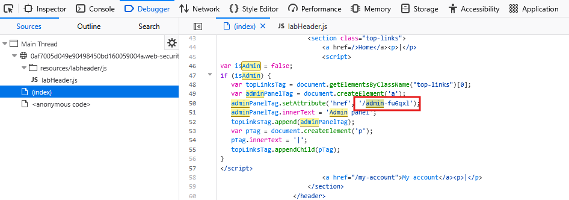
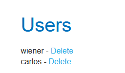

# Lab: Unprotected admin functionality

## Description
Find the admin panel in an unpredictable location and delete the user "carlos."

## Walkthrough

The lab opens to a blog page, similar to the previous one. First, we need to find the URL of the admin panel.

### Find the URL

We'll try inspecting the code. Open up the browser's dev tools and take a look at (index). Let's search for "admin."

This seems promising! Let's try it out. Append the attribute shown here to the end of the current URL.

We found it! Now, let's delete the user "carlos."

## Analysis