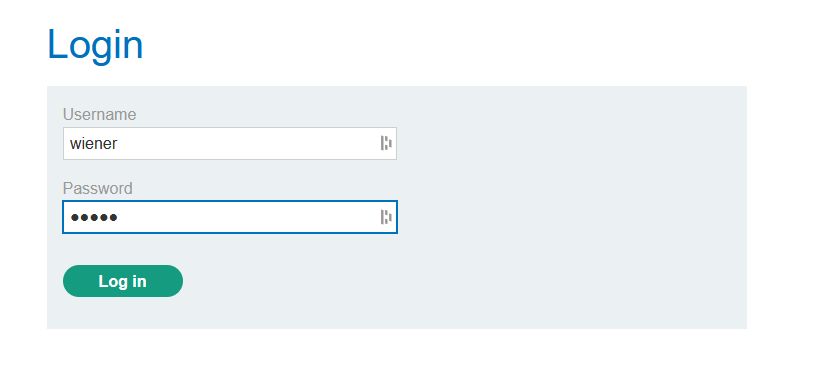
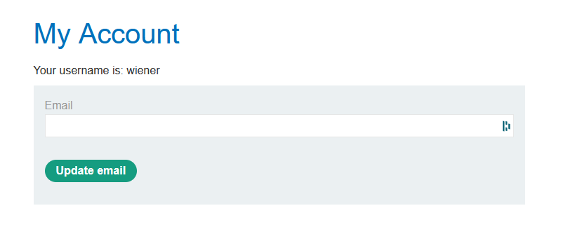
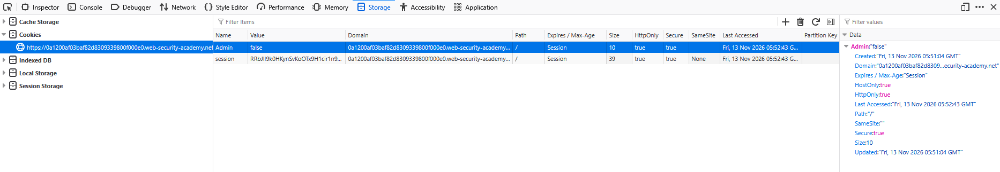
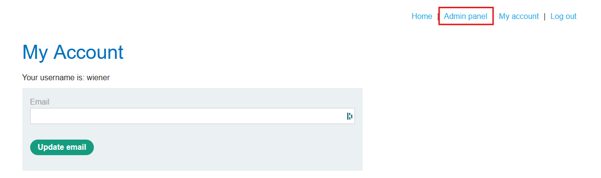

# Lab: User role controlled by request parameter

## Description

Access the admin panel and delete the user "carlos." Admins are recognized using a cookie.

## Walkthrough

We are given the credentials "wiener:peter" so let's try to log in.

Now, we're taken to our account with nothing visibly useful. Let's try looking through the dev tools again.

We know admins are recognized using cookies, so we'll take a look at the Storage tab this time.

This Admin cookie seems to be it! Let's try and update the value to "true." After a quick refresh, a link to the admin panel appears up at the top.

Here we are again! Now, we can delete "carlos" once again.

## Analysis
The application makes an attempt at checking authorization for the admin panel, but it was insufficient this time since we were able to manipulate the value to whatever we want. Real world systems need to have more robust methods of authentication and authorization to protect against hackers.