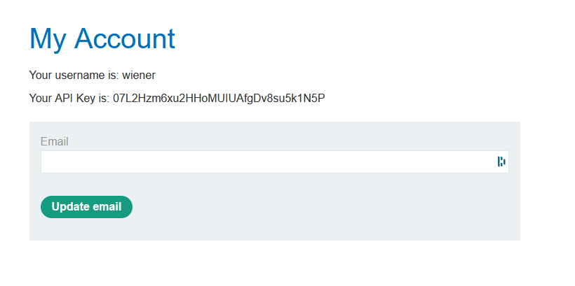
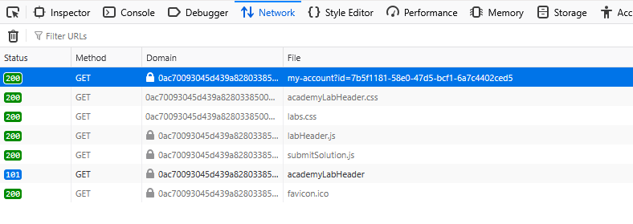
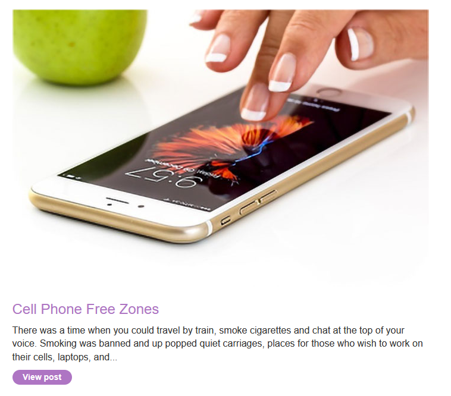
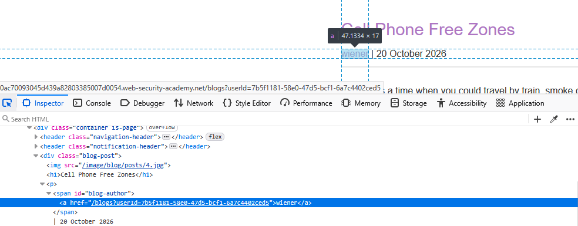
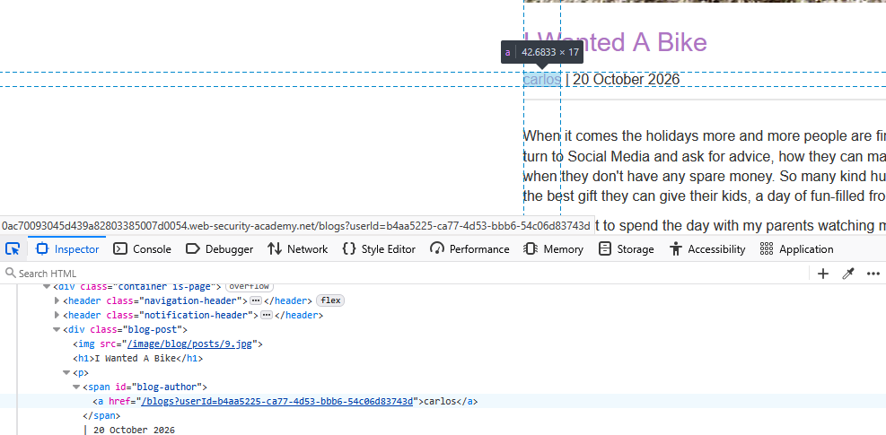
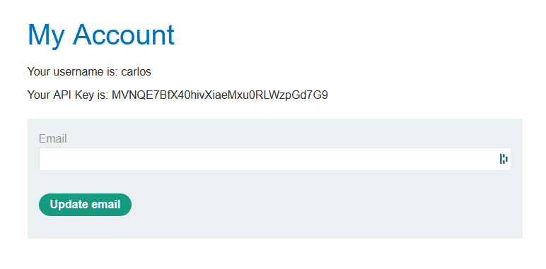

# Lab: User role controlled by request parameter, with unpredictable user IDs

## Description

Find the GUID for "carlos" and submit his API key on the user account page.

## Walkthrough

We know the vulnerability is on the account page, so let's try to log in.

Here we have our GUID. Let's see if we can find carlos's GUID anywhere.

In the network tab of the dev tools, we can see that we are identified using an ID. Let's go back to the home page and see if we can find anything else.

The home page has a few articles, what will we see inside? Let's click on the first one.

Interestingly, there is a section showing that our user is the other, and when we take a look using the dev tools, the link contains our user ID! Let's see if we can find one for carlos.

It turns out that the second article in the home page was written by carlos! Note down his user ID (b4aa5225-ca77-4d53-bbb6-54c06d83743d).

Let's head back to our account page and replace our user ID with carlos's user ID. We've successfully entered carlos's account page! Clicking on "Submit Solution" at the top and entering carlos's GUID completes the lab.

## Analysis
This is another example of an authorization flaw that is easily exploitable by bad actors. The page does not check that we are the correct user before loading for us. The site should have checked not only that we were logged in, but also that we were the correct user.